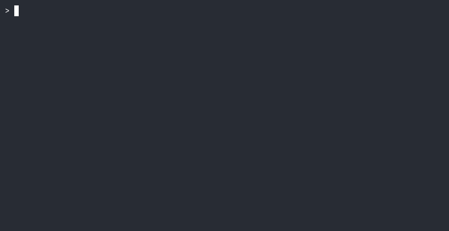

<div style="text-align: center;">

<h1>Salaryman</h1>
<h3>A minimal AI agent defined by its skills.</h3>

</div>

---
Agents are bundles. Bundles are three things:
- prose in a `SKILL.md`, 
- a tool, 
- a schema. 

Cheap enough that the bundler is itself a bundle: 

> **an agent that builds agents**, at the same cost.

---

## Getting started

Install salaryman

```bash
curl -fsSL https://raw.githubusercontent.com/p-phi/salaryman/main/install.sh | bash
```

Then point it at a model:

```bash
export SALARYMAN_ENDPOINT="http://localhost:11434/v1/chat/completions"
export SALARYMAN_MODEL="llama3.2"
```

And run an agent (a directory containing one or more bundles):

```bash
salaryman bundles/shell-run --run "what's in this repository?"
```

<div style="text-align: center;">

</div>

N.B: Sample bundles can be downloaded from this repo under bundles. 


**Dependencies:** `bash`, `curl`, `jq` — plus whatever a tool script invokes (git for the shell bundle's git commands, python3 for a Python tool).

---

## Two agents included

This project ships two agents. Both are bundles — there is no other kind of thing.

`bundles/shell-run` — runs a restricted shell. One tool, run, which accepts a single command from a fixed allowlist: `ls`, `cat`, `head`, `tail`, `wc`, `grep`, `git status`, `git diff`, `git log`. 

```bash
salaryman bundles/shell-run --run "what changed in the last commit?"
```

`bundles/make-bundle` — builds skill bundles from a prompt. Its skill is `make-bundle`: it reads the format, reads the templates, and writes a new bundle using four narrow file tools (`read_file`, `write_file`, `make_dir`, `make_executable`). The format and templates live in its `SKILL.md`, so they are readable and editable.

```bash
salaryman bundles/make-bundle --run "create a bundle that reads files and lists directories"
```

The bundler is the design applied to itself: an agent whose skill is producing agents. It is also the reason the bundle format is documented in prose — the documentation is the bundler's prompt.

---

## Architecture

A harness, a skills directory, and a loop:

```
harness (250 lines of bash)
  ├─ loads skills/*/SKILL.md    → system prompt
  ├─ loads skills/*/schemas/    → tool registry
  └─ loop: model → tool call → script → result → model
```

Four decisions follow from that shape:

- No general invocation path. The registry is the authority. There is no shell, no eval, no arbitrary command. The model can only ask for declared tools.
- A skill is a fixed prompt. Tools are optional. A skill bundle with only SKILL.md is a conversational agent.
- The harness trusts the skill. No validation, no sandboxing. A tool that can't handle a bad argument needs a better script.
- Bundles are provider-neutral. Provider translation is a branch in the client, not a change to any bundle.

**Composition is a salaryman.** 

A bundle whose tool runs another salaryman composes them; a new feature is a bundle, and a composition of features is a bundle that calls bundles. The unit of composition is the same as the unit of execution.

---

## A Skill Bundle

```
skills/shell-run/       # the bundle
  SKILL.md          # prose: when and how
  schemas/
    run.json
  tools/
    run.sh
```

`SKILL.md` is prose — when to use the tool, how to interpret the result, what not to do:

```markdown
---
name: shell
description: Run read-only commands from an allowlist
---

You can run a small set of read-only commands with the `run` tool.

The allowlist is: ls, cat, head, tail, wc, grep, git status, git diff,
git log.

That is the whole list. You cannot run anything else — not `rm`, not
`curl`, not a pipeline, not a redirect.

If you need a command that is not on the list, say so. Do not try to
work around the allowlist.
```

The harness never parses `SKILL.md`; it concatenates it into the system prompt.

`schemas/run.json` declares a tool completely:

```json
{
  "name": "run",
  "description": "Run a single read-only command from the allowlist. No pipes, redirects, subshells, or command substitution.",
  "script": "tools/run.sh",
  "parameters": {
    "type": "object",
    "properties": {
      "command": {
        "type": "string",
        "description": "A single command from the allowlist, e.g. 'ls -la', 'cat README.md', 'git status'."
      }
    },
    "required": ["command"]
  }
}
```

The harness reads script to know what to run. The model reads name, description, and parameters to know when and how to call it. One file, three jobs.

tools/run.sh receives its arguments as JSON on stdin, checks the command against the allowlist, and runs it:

```bash
#!/usr/bin/env bash
set -euo pipefail

ALLOWLIST=(
  "ls" "cat" "head" "tail" "wc" "grep"
  "git status" "git diff" "git log"
)

fail() {
  echo "error: $1" >&2
  echo "allowed: ls, cat, head, tail, wc, grep, git status, git diff, git log" >&2
  exit 1
}

...
```

The schema is shaped like a general shell. The script is not. The narrowness is in the script, and the script is readable.


A skill is defined by its `SKILL.md`; `schemas/` and `tools/` are optional. A skill bundle with only `SKILL.md` is a conversational agent — it reasons and responds, but has no action surface.

---

## What a tool writes on failure

The harness only cares about the channel: arguments in on stdin, result on stdout, non-zero exit on failure. It does not parse your errors. But the model is the reader — an error it can't parse is an error it can't recover from.

So write failure output for the model: say what failed, and what the caller could do differently. The shell bundle's `fail()` does exactly that:

```
error: 'rm' is not in the allowlist.
allowed: ls, cat, head, tail, wc, grep, git status, git diff, git log
```

The model reads it, picks an allowed command, and continues.

---

## The model

Bundles are provider-neutral: the schema is common-subset JSON Schema (type, properties, required, description). The client wraps it in the provider's envelope and normalizes the response to {name, arguments}. Adding a provider is a branch in the client, not a change to any bundle.

`SALARYMAN_API_KEY` is optional; set it for a hosted provider that requires a bearer token.

---

## Status

Early. The loop, the loader, the self-describing schema, and the Ollama client are the interesting parts. If you build a bundle, add a provider, or port the harness, the design is the contribution and the code is the proof.

License

MIT.
